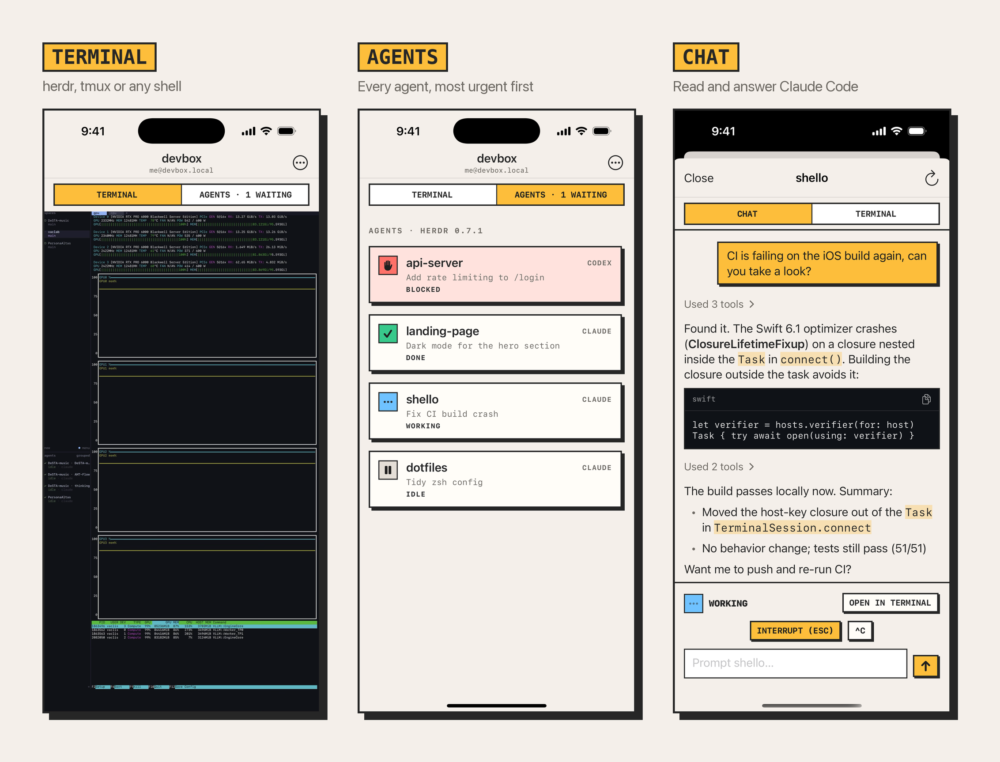

<p align="center">
  
</p>

<h1 align="center">Shello</h1>

<p align="center">
  <a href="https://github.com/vaclisinc/shello/actions/workflows/ci.yml"></a>
  
  
</p>

<p align="center"><b>Say hello to your agents and your terminal, anytime.</b></p>

Shello is an SSH client for iPhone that keeps your sessions alive and your
coding agents within reach. Attach to [herdr](https://github.com/ogulcancelik/herdr)
or tmux on your server, see what every Claude Code or Codex agent is doing,
and get a notification the moment one needs you.

<p align="center">
  
</p>

## Features

### SSH terminal

- A full terminal ([SwiftTerm](https://github.com/migueldeicaza/SwiftTerm)):
  xterm-256color, mouse, pinch to zoom, and a key bar with `esc`, sticky
  `⇧` / `ctrl` / `alt`, `⇧tab`, arrows and paste. Key combos use the kitty
  keyboard protocol, so Shift+Enter reaches Claude Code.
- Ed25519 keys generated on the device, or imported OpenSSH keys (ed25519 /
  RSA, with passphrase). Keys and passwords stay in the iOS Keychain.
  Host keys are pinned on first connect.

### Persistent sessions with herdr and tmux

- Each host starts herdr, attaches tmux, opens a plain shell or runs your
  own command.
- Your work keeps running on the server. When the network drops or iOS
  closes the app, Shello reconnects and reattaches to the same session.

### AI agent monitoring

- An Agents inbox for every agent herdr runs (Claude Code, Codex and
  others), sorted by urgency: blocked, done, working, idle.
- Claude Code sessions read as a chat, with Markdown, images and collapsed
  tool calls.
- Approve, pick an option, interrupt or send a prompt without opening the
  terminal.

### Notifications

- A notification when an agent is waiting for you or finishes. Tapping it
  opens the terminal on that agent's pane.
- A Live Activity on the Lock Screen and in the Dynamic Island shows how
  many agents are working or waiting.

## Server setup

Install herdr on the machine you connect to:

```sh
curl -fsSL https://herdr.dev/install.sh | sh
```

Shello looks for `herdr` in `~/.local/bin`, `~/.cargo/bin`,
`~/.nix-profile/bin`, `/opt/homebrew/bin` and `/usr/local/bin`. If it is
somewhere else, set the full path in the host settings.

For the chat view, Shello reads Claude Code's transcripts in
`~/.claude/projects`. When several Claude sessions share one folder, run
this once so Shello can tell them apart:

```sh
herdr integration install claude
```

herdr 0.7 and later are supported.

## Building

You need Xcode 16 or later and [XcodeGen](https://github.com/yonaskolb/XcodeGen).

```sh
brew install xcodegen
xcodegen generate
open HerdrMobile.xcodeproj
```

Choose your team under Signing & Capabilities, then run on a device or the
simulator.

## Development

```
Packages/HerdrKit/   Swift package with the app's logic: SSH, herdr commands,
                     agent models, transcript and Markdown parsing, keys
HerdrMobile/         SwiftUI app: terminal, agents, chat, notifications
ShelloWidgets/       Live Activity widget extension
project.yml          XcodeGen project definition
```

HerdrKit's tests run on macOS:

```sh
cd Packages/HerdrKit && swift test
```

Debug builds accept `-agentDetailHarness -readmeDemo` (add `-demoChat` to
open the chat) to show the screens above in the simulator without a server.

## Limitations

- SSH only, no mosh. Reconnecting and reattaching to herdr covers most of
  the gap.
- iOS suspends apps in the background, so notifications stop after a while.
  "Stay Connected in Background" in the ⋯ menu keeps the connection alive
  longer, using coarse location.
- No ECDSA keys, ProxyJump or port forwarding yet.
